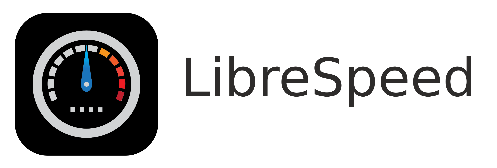

# LibreSpeed

No Flash, No Java, No WebSocket, No Bullshit.

This is a very lightweight speed test implemented in JavaScript, using XMLHttpRequest and Web Workers.

## Try it
[Take a speed test](https://speedtest.zzz.cat)

## Compatibility
All modern browsers are supported: IE11, latest Edge, latest Chrome, latest Firefox, latest Safari.
Works with mobile versions too.

## Features
* Download
* Upload
* Ping
* Jitter
* IP Address, ISP, distance from server (optional)
* Telemetry (optional)
* Results sharing via PNG image and JSON API (optional)
* Multiple Points of Test (optional)
* Compatible with PHP frontend predefined endpoints (with `.php` suffixes)
* Supports [Proxy Protocol](https://www.haproxy.org/download/2.3/doc/proxy-protocol.txt)
* Modern and classic UI designs with switchable interface
* ID obfuscation for test result privacy (optional)

### IP Detection
* Client IP detection with proxy header chain support (X-Forwarded-For, X-Real-IP, Client-IP, CF-Connecting-IPv6)
* ISP and location detection via ipinfo.io API with offline GeoIP database fallback (MaxMind .mmdb)
* Private/special IP detection (including ULA IPv6 and CGNAT)
* Distance calculation with human-friendly rounding


## Server requirements
* Any [Go supported platforms](https://github.com/golang/go/wiki/MinimumRequirements) (Go 1.21+)
* SQLite, BoltDB, PostgreSQL, MySQL or MSSQL database to store test results (optional)
* No external dependencies — single binary deployment
* A fast! Internet connection

## Installation

### Install using prebuilt binaries

1. Download the appropriate binary file from the [releases](https://github.com/librespeed/speedtest-go/releases/) page.
2. Unzip the archive.
3. Make changes to the configuration.
4. Run the binary.
5. Optional: Setup a systemd service file.

### Use Ansible for automatic installation

You can use an Ansible role for installing speedtest-go easily. You can find the role on the [Ansible galaxy](https://galaxy.ansible.com/flymia/ansible_speedtest_go). There is a [separate repository](https://github.com/flymia/ansible-speedtest_go) for documentation about the Ansible role.
### Compile from source

You need Go 1.21+ to compile the binary.

1. Clone this repository:

    ```
    $ git clone https://github.com/librespeed/speedtest-go
    ```

2. Build
    ```
    # Change current working directory to the repository
    $ cd speedtest-go
    # Compile
    $ go build -ldflags "-w -s" -trimpath -o speedtest main.go
    ```

3. Copy the `assets` directory, `settings.toml` file along with the compiled `speedtest` binary into a single directory

4. If you have telemetry enabled,
    - For PostgreSQL/MySQL/MSSQL, create database and import the corresponding `.sql` file under `database/{postgresql,mysql,mssql}`

        ```
        # assume you have already created a database named `speedtest` under current user
        $ psql speedtest < database/postgresql/telemetry_postgresql.sql
        ```

    - For embedded databases (BoltDB, SQLite), make sure to define the `database_file` path in `settings.toml`:

        ```
        database_file="speedtest.db"
        ```

    - SQLite supports WAL mode for better concurrent performance and works out of the box with no additional dependencies.

5. Put `assets` folder under the same directory as your compiled binary.
    - Make sure the font files and JavaScripts are in the `assets` directory
    - You can have multiple HTML pages under `assets` directory. They can be access directly under the server root
    (e.g. `/example-singleServer-full.html`)
    - It's possible to have a default page mapped to `/`, simply put a file named `index.html` under `assets`

6. Change `settings.toml` according to your environment:

    ```toml
    # bind address, use empty string to bind to all interfaces
    bind_address="127.0.0.1"
    # backend listen port, default is 8989
    listen_port=8989
    # proxy protocol port, use 0 to disable
    proxyprotocol_port=0
    # Server location, use zeroes to fetch from API automatically
    server_lat=0
    server_lng=0
    # ipinfo.io API key, if applicable
    ipinfo_api_key=""
   
    # assets directory path, defaults to `assets` in the same directory
    # if the path cannot be found, embedded default assets will be used
    assets_path="./assets"

    # password for logging into statistics page, change this to enable stats page
    statistics_password="PASSWORD"
    # redact IP addresses
    redact_ip_addresses=false

    # database type for statistics data, currently supports: none, memory, bolt, sqlite, mysql, postgresql, mssql
    # if none is specified, no telemetry/stats will be recorded, and no result PNG will be generated
    database_type="postgresql"
    # For MySQL, include the driver network prefix and port in the hostname:
    # database_hostname="tcp(127.0.0.1:3306)"
    database_hostname="localhost"
    database_name="speedtest"
    database_username="postgres"
    database_password=""

    # database port (optional, defaults to driver default; only used by mssql)
    database_port=""

    # if you use `bolt` or `sqlite` as database, set database_file to database file location
    database_file="speedtest.db"

    # GeoIP offline database (.mmdb format) for ISP detection fallback (optional)
    # Leave empty to disable.
    # geoip_database_file="country_asn.mmdb"

    # TLS and HTTP/2 settings. TLS is required for HTTP/2
    enable_tls=false
    enable_http2=false

    # if you use HTTP/2 or TLS, you need to prepare certificates and private keys
    # tls_cert_file="cert.pem"
    # tls_key_file="privkey.pem"
    ```

## Differences between Go and PHP implementation and caveats

- Test IDs are generated as ULID (Universally Unique Lexicographically Sortable Identifier), unlike the PHP version's auto-increment integer IDs
- ID obfuscation is available as an optional feature — when enabled, ULIDs are obfuscated with a per-instance salt
- The Go version ships with three front-end pages: `index.html` (the default, served at `/`), `index-classic.html`, and `index-modern.html` — pick one by requesting it directly (e.g. `/index-modern.html`); there is no `?design=` URL switch between them
- `index.html` and `index-modern.html` render the same style of canvas gauges (sharing the drawing code in `javascript/gauges.js`), just with different page chrome — `index-modern.html` wears the fromScratch Studio stylesheet and additionally supports multi-server configuration via `server-list.json` placed alongside the binary
- Server location can be defined in settings or auto-detected at startup
- There might be a slight delay on program start if your Internet connection is slow. That's because the program will
attempt to fetch your current network's ISP info for distance calculation between your network and the speed test client's.
This action will only be taken once, and cached for later use.

## License
Copyright (C) 2016-2020 Federico Dossena
Copyright (C) 2020 Maddie Zhan

This program is free software: you can redistribute it and/or modify
it under the terms of the GNU Lesser General Public License as published by
the Free Software Foundation, either version 3 of the License, or
(at your option) any later version.

This program is distributed in the hope that it will be useful,
but WITHOUT ANY WARRANTY; without even the implied warranty of
MERCHANTABILITY or FITNESS FOR A PARTICULAR PURPOSE.  See the
GNU General Public License for more details.

You should have received a copy of the GNU Lesser General Public License
along with this program.  If not, see <https://www.gnu.org/licenses/lgpl>.
